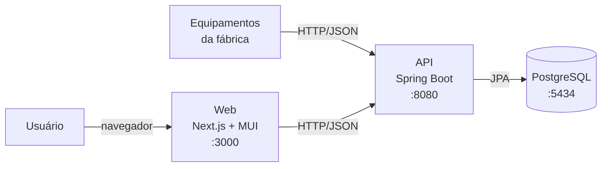
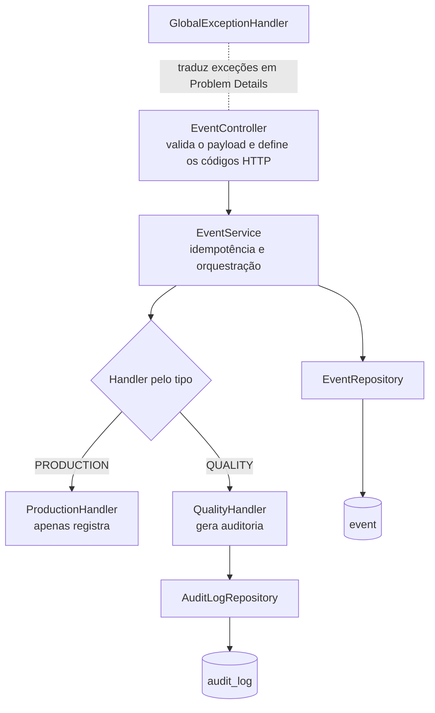

# Certamen Artis · Eventos da Fábrica

Solução **Fullstack** para recebimento, processamento e consulta de eventos enviados por equipamentos de uma fábrica.

- **API** em Java 17 + Spring Boot 4, com PostgreSQL e Flyway
- **Web** em Next.js 16 + React + TypeScript + Material UI
- Tudo sobe com **um único comando** via Docker Compose

> **Autor:** Ednilton Rauh · [edrauh@gmail.com](mailto:edrauh@gmail.com)

---

## Sumário

1. [O problema](#1-o-problema)
2. [Tecnologias](#2-tecnologias)
3. [Estrutura do repositório](#3-estrutura-do-repositório)
4. [Como executar a aplicação (Docker)](#4-como-executar-a-aplicação-docker)
5. [Como executar backend e frontend separadamente](#5-como-executar-backend-e-frontend-separadamente)
6. [Como executar os testes](#6-como-executar-os-testes)
7. [Usando a API](#7-usando-a-api)
8. [Arquitetura](#8-arquitetura)
9. [Principais decisões técnicas](#9-principais-decisões-técnicas)
10. [Logs e observabilidade](#10-logs-e-observabilidade)
11. [Possíveis melhorias futuras](#11-possíveis-melhorias-futuras)
12. [Autor](#12-autor)

---

## 1. O problema

Equipamentos externos da fábrica enviam eventos. Cada evento tem:

| Campo | Exemplo |
|---|---|
| ID único do evento | `EVT-1001` |
| Data/hora | `2026-05-20T10:00:00` |
| Tipo | `PRODUCTION` ou `QUALITY` |
| Descrição | `Production line started` |

O sistema precisa:

- ✅ **Registrar** os eventos recebidos
- ✅ **Impedir processamento duplicado** (o mesmo `eventId` não é processado duas vezes)
- ✅ **Retornar mensagens adequadas** em caso de erro
- ✅ Eventos **PRODUCTION** → apenas registrados
- ✅ Eventos **QUALITY** → registrados **e** geram um registro de **auditoria**

E oferecer uma interface web para **cadastrar** e **consultar** os eventos.

---

## 2. Tecnologias

| Camada | Tecnologia | Por quê |
|---|---|---|
| Backend | **Java 17 + Spring Boot 4.1** | Stack de referência da vaga, maduro e produtivo |
| Persistência | **Spring Data JPA / Hibernate 7** | Mapeamento objeto-relacional e repositórios sem SQL manual |
| Banco | **PostgreSQL 16** | Banco relacional robusto, com `UNIQUE` e `TIMESTAMPTZ` |
| Migrations | **Flyway** | Schema versionado e reproduzível em qualquer ambiente |
| Documentação da API | **springdoc-openapi (Swagger UI)** | Documentação interativa gerada a partir do código |
| Testes (API) | **JUnit 5, Mockito, MockMvc, Testcontainers** | Testes unitários, de camada web e de integração com Postgres real |
| Frontend | **Next.js 16 (App Router) + React + TypeScript** | Tipagem forte e estrutura moderna de aplicação React |
| UI | **Material UI (MUI)** | Componentes acessíveis e consistentes, prontos para uso |
| Infraestrutura | **Docker + Docker Compose** | Sobe banco, API e web com um comando |

---

## 3. Estrutura do repositório

```
certamen-artis/
├── api/                          → Backend (Spring Boot)
│   ├── src/main/java/com/certamen/artis/
│   │   ├── config/               → CORS e deserialização de datas
│   │   ├── controller/           → Endpoints REST
│   │   ├── domain/               → Entidades JPA (Event, AuditLog) e enum EventType
│   │   ├── dto/                  → Objetos de entrada/saída da API
│   │   ├── exception/            → Exceções de negócio e tratamento global de erros
│   │   ├── repository/           → Repositórios Spring Data
│   │   └── service/              → Regras de negócio
│   │       └── handler/          → Um handler por tipo de evento (Strategy)
│   ├── src/main/resources/
│   │   ├── application.yaml
│   │   └── db/migration/         → Scripts Flyway (V1, V2, V3)
│   ├── src/test/java/...         → Testes unitários, web e de integração
│   └── Dockerfile
│
├── web/                          → Frontend (Next.js + MUI)
│   ├── src/app/                  → Layout e página principal
│   ├── src/components/events/    → Formulário, tabela, chip de tipo, mensagens
│   ├── src/hooks/                → useEvents (carregamento da lista)
│   ├── src/lib/                  → Cliente HTTP da API
│   ├── src/utils/                → Formatação de datas e rótulos
│   └── Dockerfile
│
├── docker-compose.yaml           → Sobe postgres + api + web
└── README.md
```

---

## 4. Como executar a aplicação (Docker)

Esta é a forma **recomendada**: não exige Java nem Node instalados.

### Pré-requisitos

- [Docker Desktop](https://www.docker.com/products/docker-desktop/) (ou Docker Engine + Compose v2)
- Portas livres: **3000** (web), **8080** (api) e **5434** (postgres)

### Passo a passo

```bash
# 1. Clone o repositório
git clone <url-do-repositorio>
cd certamen-artis

# 2. Suba tudo
docker compose up --build -d

# 3. Acompanhe a inicialização (Ctrl+C para sair dos logs)
docker compose logs -f api
```

A primeira execução leva alguns minutos, porque as dependências do Maven e do npm são baixadas. Quando aparecer `Started ArtisApplication`, está pronto.

### Endereços

| O quê | Endereço |
|---|---|
| 🖥️ **Interface web** | http://localhost:3000 |
| 📘 **Swagger (documentação da API)** | http://localhost:8080/swagger-ui.html |
| 🔌 API REST | http://localhost:8080/api/events |
| ❤️ Health check | http://localhost:8080/actuator/health |
| 🐘 PostgreSQL | `localhost:5434` · banco `certamen_artis` · usuário/senha `postgres` |

### Parar e limpar

```bash
docker compose down        # para os containers (mantém os dados)
docker compose down -v     # para e apaga o banco (começa do zero na próxima vez)
```

---

## 5. Como executar backend e frontend separadamente

Útil para desenvolvimento, com hot reload.

### 5.1 Backend (API)

**Pré-requisitos:** Java 17+ e Docker (apenas para o PostgreSQL).

```bash
# 1. Suba só o banco
docker compose up -d postgres

# 2. Rode a API
cd api
./mvnw spring-boot:run          # Windows (cmd/PowerShell): mvnw.cmd spring-boot:run
```

A API sobe em http://localhost:8080 e conecta no Postgres em `localhost:5434`. O Flyway cria as tabelas automaticamente na primeira execução.

> As configurações podem ser sobrescritas por variáveis de ambiente: `SPRING_DATASOURCE_URL`, `SPRING_DATASOURCE_USERNAME`, `SPRING_DATASOURCE_PASSWORD`, `CORS_ALLOWED_ORIGINS` e `SHOW_SQL=true` (para exibir as queries no log).

### 5.2 Frontend (Web)

**Pré-requisitos:** Node.js 20+ e a API rodando.

```bash
cd web
npm install
cp .env.example .env.local      # define NEXT_PUBLIC_API_URL=http://localhost:8080
npm run dev
```

Acesse http://localhost:3000.

| Comando | O que faz |
|---|---|
| `npm run dev` | Servidor de desenvolvimento com hot reload |
| `npm run build` | Build de produção (inclui checagem de tipos) |
| `npm run start` | Executa o build de produção |
| `npm run lint` | Análise estática com ESLint |

---

## 6. Como executar os testes

Os testes ficam no backend e cobrem as regras do enunciado em três níveis.

**Pré-requisitos:** Java 17+ e **Docker em execução** (os testes de integração sobem um PostgreSQL descartável via Testcontainers). Não é preciso subir o `docker compose`.

```bash
cd api
./mvnw test                     # Windows: mvnw.cmd test
```

Resultado esperado:

```
Tests run: 25, Failures: 0, Errors: 0, Skipped: 0
BUILD SUCCESS
```

### O que é testado

| Classe | Tipo | O que garante |
|---|---|---|
| `EventServiceTest` | Unitário (Mockito) | Registro do evento, delegação ao handler correto, bloqueio de duplicados (inclusive em requisições concorrentes), ordenação da listagem, falha rápida se houver dois handlers para o mesmo tipo |
| `QualityHandlerTest` | Unitário (Mockito) | Evento QUALITY grava um `AuditLog` com o `eventId` e a ação corretos |
| `EventControllerTest` | Camada web (`@WebMvcTest`) | Contrato HTTP: 201, 409, 400 (JSON malformado, tipo inexistente, campo obrigatório, tamanho máximo), 404 e serialização das datas |
| `EventFlowIntegrationTest` | Integração (Testcontainers) | Fluxo ponta a ponta contra PostgreSQL real: PRODUCTION sem auditoria, QUALITY com auditoria, duplicado, fuso horário, payload do enunciado e ordenação |
| `ArtisApplicationTests` | Integração | O contexto completo sobe, o Flyway aplica as migrations e o Hibernate valida o schema |

### Problemas comuns

- **`Could not find a valid Docker environment`**: o Docker Desktop precisa estar aberto.
- **Falha ao baixar a imagem `testcontainers/ryuk`**: baixe-a manualmente com `docker pull testcontainers/ryuk:0.14.0` ou desative o Ryuk com `export TESTCONTAINERS_RYUK_DISABLED=true` antes de rodar os testes.

---

## 7. Usando a API

A documentação interativa completa está no **Swagger**: http://localhost:8080/swagger-ui.html

### Endpoints

| Método | Rota | Descrição |
|---|---|---|
| `POST` | `/api/events` | Recebe e processa um evento |
| `GET` | `/api/events` | Lista os eventos, do mais recente para o mais antigo |

### Exemplo: registrar um evento

O payload de exemplo do enunciado é aceito **exatamente como está**:

```bash
curl -i -X POST http://localhost:8080/api/events \
  -H "Content-Type: application/json" \
  -d '{
        "eventId": "EVT-1001",
        "eventType": "PRODUCTION",
        "description": "Production line started",
        "timestamp": "2026-05-20T10:00:00"
      }'
```

Resposta `201 Created`:

```json
{
  "id": "1ae64641-e1a1-4164-afe6-f7e836a3ad58",
  "eventId": "EVT-1001",
  "eventType": "PRODUCTION",
  "description": "Production line started",
  "eventTime": "2026-05-20T10:00:00Z",
  "createdAt": "2026-10-25T22:01:34.533227Z"
}
```

### Campos aceitos

| Campo | Obrigatório | Regras |
|---|---|---|
| `eventId` | Sim | Texto, até 255 caracteres. É a chave de idempotência. |
| `eventType` | Sim | `PRODUCTION` ou `QUALITY` |
| `description` | Não | Texto, até 2000 caracteres |
| `eventTime` (ou `timestamp`) | Sim | ISO-8601. Com fuso (`2026-05-20T10:00:00Z`, `2026-05-20T07:00:00-03:00`) ou sem fuso (`2026-05-20T10:00:00`, tratado como UTC). A resposta sempre devolve em UTC. |

### Códigos HTTP

| Código | Quando |
|---|---|
| `201 Created` | Evento registrado com sucesso |
| `200 OK` | Listagem de eventos |
| `400 Bad Request` | Campo obrigatório ausente, tamanho excedido, tipo inexistente, data inválida ou JSON malformado |
| `404 Not Found` | Rota inexistente |
| `405 Method Not Allowed` | Método HTTP não suportado na rota |
| `409 Conflict` | Evento com esse `eventId` já foi processado |
| `500 Internal Server Error` | Erro inesperado (o detalhe técnico vai apenas para o log) |

### Formato dos erros

Todos os erros seguem o padrão **Problem Details (RFC 9457)**, com `Content-Type: application/problem+json`:

```json
{
  "type": "https://api.certamen.artis/errors/duplicate-event",
  "title": "Evento Duplicado",
  "status": 409,
  "detail": "O evento com ID EVT-1001 já foi processado.",
  "instance": "/api/events"
}
```

Erros de validação trazem também os campos inválidos:

```json
{
  "title": "Erro de Validação",
  "status": 400,
  "detail": "Um ou mais campos estão inválidos.",
  "invalid_fields": { "eventId": "O eventId é obrigatório" }
}
```

---

## 8. Arquitetura

### Visão geral



### Backend em camadas



### Fluxo de um evento

1. O **controller** recebe o JSON e o Bean Validation verifica os campos obrigatórios.
2. O **service** verifica se o `eventId` já existe. Se existir, responde **409**.
3. O evento é salvo. A constraint `UNIQUE` do banco garante a idempotência mesmo com requisições simultâneas.
4. O service localiza o **handler do tipo** e delega a regra específica:
    - `ProductionHandler`: apenas registra no log.
    - `QualityHandler`: grava um registro na tabela `audit_log`.
5. Os passos 3 e 4 rodam **na mesma transação**: se a auditoria falhar, o evento também é desfeito.
6. A API devolve **201** com o evento criado.

### Modelo de dados

```
event                                   audit_log
├── id          UUID (PK)               ├── id          UUID (PK)
├── event_id    VARCHAR(255) UNIQUE ◄───┼── event_id    VARCHAR(255) (FK, indexado)
├── event_type  VARCHAR(50)             ├── action      VARCHAR(100)
├── description TEXT                    └── created_at  TIMESTAMPTZ
├── event_time  TIMESTAMPTZ
└── created_at  TIMESTAMPTZ
```

### Frontend

```
page.tsx
└── EventsDashboard        → orquestra o cadastro, a lista e as mensagens
    ├── EventForm          → formulário com validação local e erros por campo vindos da API
    ├── EventsTable        → tabela com estados de carregando, erro e vazio
    │   └── EventTypeChip  → rótulo e cor por tipo de evento
    └── FeedbackSnackbar   → mensagens de sucesso, aviso (duplicado) e erro

hooks/useEvents.ts         → busca a lista e expõe loading, error e refresh
lib/api.ts                 → cliente HTTP; converte Problem Details em ApiError
```

---

## 9. Principais decisões técnicas

### Strategy para os tipos de evento

Cada tipo de evento tem seu próprio **handler** (`EventHandler`). O `EventService` monta um mapa `tipo → handler` na inicialização e apenas delega.

- **Por quê:** a regra de cada tipo fica isolada e testável. Um novo tipo exige apenas uma nova classe que implemente `EventHandler`, sem `if/else` crescendo no service (princípio aberto/fechado).
- **Proteção extra:** se dois handlers declararem o mesmo tipo, a aplicação falha na inicialização, em vez de escolher um dos dois em silêncio.

### Idempotência em duas camadas

1. **`existsByEventId`**: uma checagem rápida que resolve o caso comum (reenvio do mesmo evento).
2. **Constraint `UNIQUE` no banco + `saveAndFlush`**: duas requisições simultâneas com o mesmo `eventId` podem passar juntas pela checagem. O banco é a garantia final. O `saveAndFlush` força o INSERT na hora, e a violação (SQLSTATE `23505`) é convertida em **409**. Outros erros de integridade **não** são confundidos com duplicidade.

### Evento e auditoria na mesma transação

O registro do evento e a geração da auditoria ocorrem dentro do mesmo `@Transactional`. Assim, nunca existe um evento QUALITY sem a auditoria correspondente.

### Tratamento estruturado de erros (RFC 9457)

O `GlobalExceptionHandler` estende o `ResponseEntityExceptionHandler` do Spring e devolve todos os erros no formato **Problem Details**:

- erros de negócio (409), de validação (400, com os campos inválidos) e de leitura do JSON (400);
- erros padrão do Spring MVC (404, 405, 415) tratados corretamente, em vez de virarem 500;
- erros inesperados viram 500 com mensagem genérica, e o stack trace vai **somente para o log**, sem expor detalhes internos ao cliente.

### Datas sempre em UTC

- As colunas são `TIMESTAMPTZ` e as entidades usam `OffsetDateTime`.
- A API aceita a data com qualquer fuso, ou sem fuso (tratada como UTC), e **sempre responde em UTC**.
- O frontend converte para o fuso do navegador apenas na exibição.

**Por quê:** os equipamentos de uma fábrica podem estar em fusos diferentes. Normalizar em UTC evita ambiguidade na ordenação e na auditoria.

### Compatibilidade com o payload do enunciado

O exemplo do enunciado usa o campo `timestamp`, sem fuso. A API aceita esse formato (via `@JsonAlias` e um deserializador tolerante) e também o formato ISO completo em `eventTime`.

### Banco versionado com Flyway

- O schema é criado e evoluído **somente** por migrations versionadas (`V1`, `V2`, `V3`).
- O Hibernate roda com `ddl-auto: validate`: ele não altera o banco, só confere se as entidades batem com o schema. Uma divergência impede a aplicação de subir.

### Entidades e DTOs separados

- **DTOs** (`EventRequest`, `EventResponse`) definem o contrato da API, e as **entidades** JPA nunca são expostas diretamente.
- As entidades são **imutáveis depois de criadas** (sem setters), porque um evento ou auditoria registrado não deve ser alterado.
- O UUID é gerado pelo Hibernate (`@GeneratedValue`), não manualmente, o que evita um `merge` desnecessário no lugar do `INSERT`.

### Testes com banco real (Testcontainers)

Os testes de integração usam **PostgreSQL de verdade** em container, em vez de um banco em memória como o H2. Assim, as migrations, a constraint `UNIQUE`, o `TIMESTAMPTZ` e o SQLSTATE da violação são exercitados exatamente como em produção.

### Frontend

- **Separação de responsabilidades:** o cliente HTTP (`lib/api.ts`), o estado (`useEvents`), a orquestração (`EventsDashboard`) e os componentes de apresentação (`EventForm`, `EventsTable`) ficam em arquivos distintos.
- **Erros tratados de ponta a ponta:** o cliente converte os Problem Details da API em `ApiError`, e a tela mostra a mensagem certa: sucesso (verde), duplicado (amarelo, por ser um aviso de negócio) e erro (vermelho, incluindo API fora do ar).
- **Validação nos dois lados:** o formulário valida antes de enviar e também exibe os erros por campo devolvidos pela API.
- **Sem bibliotecas de estado globais:** para o tamanho da aplicação, os hooks do React bastam. Adicionar Redux ou similar seria complexidade sem ganho.

### Infraestrutura

- **Dockerfiles multi-stage:** a imagem final contém apenas o runtime (JRE ou Node) e o artefato, sem ferramentas de build.
- **Containers sem root:** API e web rodam com um usuário sem privilégios.
- **Healthchecks encadeados:** o `web` só sobe depois que a `api` está saudável, e a `api` só sobe depois que o `postgres` está pronto.
- **CORS configurável** por variável de ambiente (`CORS_ALLOWED_ORIGINS`).

---

## 10. Logs e observabilidade

- **Logs de negócio** em cada etapa: recebimento do evento, duplicidade detectada, processamento por tipo e geração de auditoria.
- **Níveis adequados:** `INFO` para o fluxo normal, `WARN` para requisições rejeitadas (duplicado, validação) e `ERROR` com stack trace para falhas inesperadas.
- **Health check** via Spring Boot Actuator em `/actuator/health`, incluindo o status do banco. É usado pelos healthchecks do Docker Compose.
- **SQL sob demanda:** as queries do Hibernate podem ser exibidas com `SHOW_SQL=true`, sem poluir o log por padrão.

```bash
docker compose logs -f api      # acompanha os logs da API
```

---

## 11. Possíveis melhorias futuras

**Funcionalidades**
- Paginação e filtros na listagem (por tipo, por período), na API e na tabela
- Endpoint de consulta individual (`GET /api/events/{eventId}`) e de auditoria por evento
- Auditoria mais rica: payload original do evento, origem (equipamento) e usuário

**Escalabilidade e resiliência**
- Recebimento assíncrono via mensageria (Kafka ou RabbitMQ) para alto volume de eventos
- Padrão Outbox para publicar eventos de forma confiável após o registro
- Rate limiting por equipamento

**Segurança**
- Autenticação e autorização (OAuth2/JWT para usuários, API keys para equipamentos)
- Credenciais em gerenciador de segredos, em vez de variáveis em texto no compose

**Qualidade**
- Testes de frontend com Vitest e Testing Library, e testes E2E com Playwright
- Pipeline de CI (GitHub Actions) rodando build, testes e lint a cada push
- Análise de cobertura (JaCoCo) e de qualidade (SonarQube)

**Observabilidade**
- Métricas com Micrometer e Prometheus, e dashboards no Grafana
- Rastreamento distribuído (OpenTelemetry) e correlation ID entre web, api e banco
- Logs estruturados em JSON para centralização (ELK, Loki)

---

## 12. Autor

**Ednilton Rauh**
📧 [edrauh@gmail.com](mailto:edrauh@gmail.com)